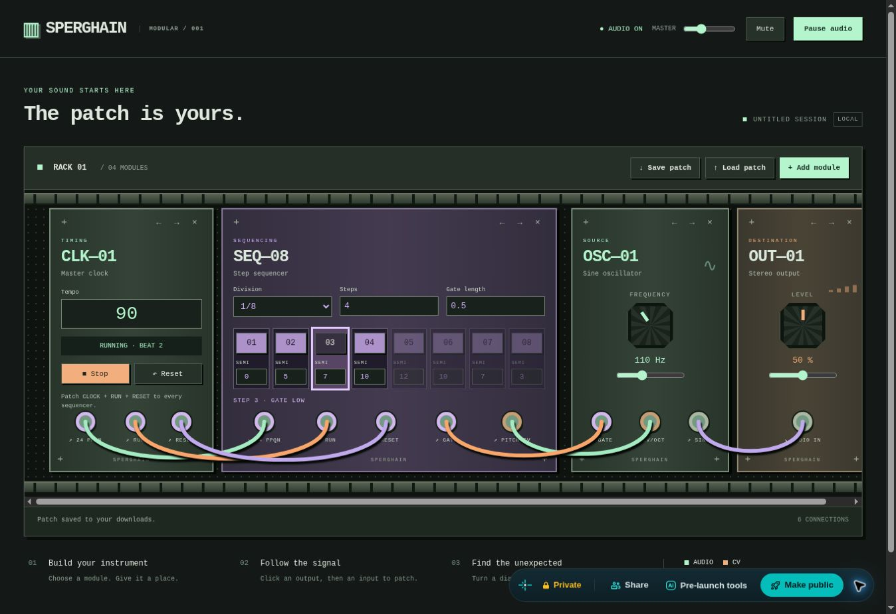

# Clock and sequencer

## First patch

Load `examples/clock-sequence.json` with Load patch, or add Master clock, Step sequencer, Sine oscillator and Stereo output to the empty rack.

| Output | Input |
| --- | --- |
| Clock 24 PPQN | Sequencer 24 PPQN |
| Clock RUN | Sequencer RUN |
| Clock RESET | Sequencer RESET |
| Sequencer PITCH CV | Oscillator 1V/OCT |
| Sequencer GATE | Oscillator GATE |
| Oscillator SINE | Output AUDIO IN |

Enable audio, then press Start on the clock. The example starts stopped. Set the oscillator frequency to your root pitch (110Hz = A2). Sequencer pitches are semitone offsets from that root, from -24 to +24; 12 semitones is +1V, doubling frequency. Click a numbered step button to toggle a rest. Rests still update pitch CV; the separate gate stays low.

Clock tempo is 30–300 BPM. Division sets the duration of **each step**: an eight-step loop at 1/16 lasts two beats; at 1/8 it lasts four beats. Steps selects loop length 1–8. Gate length is a fraction of a step (0.05–0.95); 0.5 means half the step sounds. The oscillator uses a short 2ms smoothing time on gate transitions, not a full envelope or VCA.

## Synchronisation contract

- Shared constants live in `src/contracts/timing.js` for future sequencers and clock-aware modules.
- Clock output: 24 rising pulses per quarter note, 0/5V, 50% duty. Processing uses samples at the host sample rate, independent of rendering or UI timers.
- RUN output: 5V while running, 0V when stopped. Patch it for immediate gate-off. Without RUN, a sequencer responds to pulses and finishes its current finite gate when pulses stop.
- RESET output: 1ms pulse. Start automatically resets the clock and attached sequencers; Stop then Start always restarts at step one. Reset while running restarts at step one immediately.
- The reset pulse and first clock edge may coincide; receivers reset first, then process that edge exactly once.
- Patch the three clock outputs to multiple sequencers for common phase, even at different note divisions. Adding a sequencer to a running patch starts it on the next received edge; press Reset to realign the whole rig.
- Inputs use a 1V rising-edge threshold. An unpatched sequencer RUN input defaults to 5V; CLOCK/RESET default to 0V.
- Division changes latch on the next step; length changes apply on advancement. Pitch/gate edits latch when that step is entered. Pitch holds between steps and when stopped.
- Gate duration uses the measured clock period. The first pulse after start/reset uses a provisional 100ms maximum until the second clock edge establishes tempo. Very short gate settings can make that first gate longer than subsequent gates; tempo changes also take one incoming clock interval to measure. This does not shift step timing.
- Sine oscillator's new gate input defaults high when unpatched, preserving old patches.

## Structure and limits

Clock and sequencer each own definition, processor and panel files. `modules/registry.js` registers DSP; `modules/panels.js` separately registers custom UI. Generic parameter validation now supports integer/enum constraints. The engine supports declared default input voltages. GUI polling requests processor status at 20Hz only for LEDs/playheads; it never schedules music, and status messages are handled outside the render callback.

MIDI clock, swing, triplets, ties, pattern banks, probability, ADSR envelopes and polyphonic sequencing are later features. No external device synchronisation is claimed.

## Review evidence

33 automated tests pass, including the original foundation tests. Syntax checks, the 500-line limit, static build and GitHub CI pass. The Netlify HTTPS preview was checked with the full example patch: AudioWorklet starts, beat/playhead indicators advance, Start/Stop works, and edited tempo/division/length/pitch/rest values were verified by parsing a browser-downloaded patch. No listening-based sound-quality or device latency assessment is claimed.

Preview: https://deploy-preview-2--sperghain.netlify.app/

