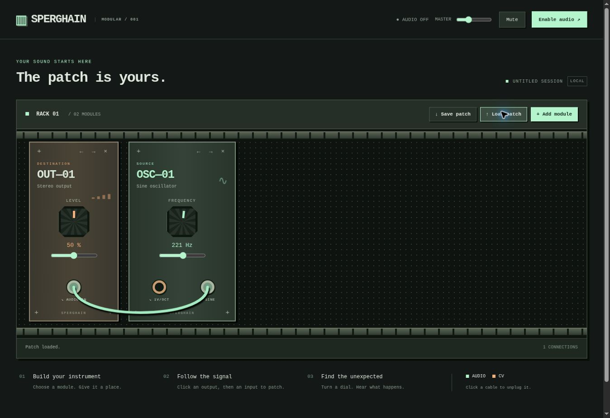

# Foundation verification — 30 October 2026

- 12 unit tests passed, covering pitch at 44.1/48kHz, +1V pitch response, routing, fan-out, silence, invalid graphs, patch round trips, instance independence and removal.
- JavaScript syntax and 500-line source limit checks passed. Static build passed.
- Browser UI checked: empty launch, module library, oscillator/output creation, cable connection, frequency keyboard control, module reordering, removal with cable cleanup, save/download, load restoring both modules and the cable.
- The managed preview runs on HTTP at a non-localhost hostname. AudioWorklet cannot run there. The UI correctly reports that audio requires HTTPS or localhost. Actual live browser sound and latency remain unverified; test these on a Netlify HTTPS preview before approving production.
- Native plugin, external MIDI, dragging, undo, and feedback routing are not implemented.

